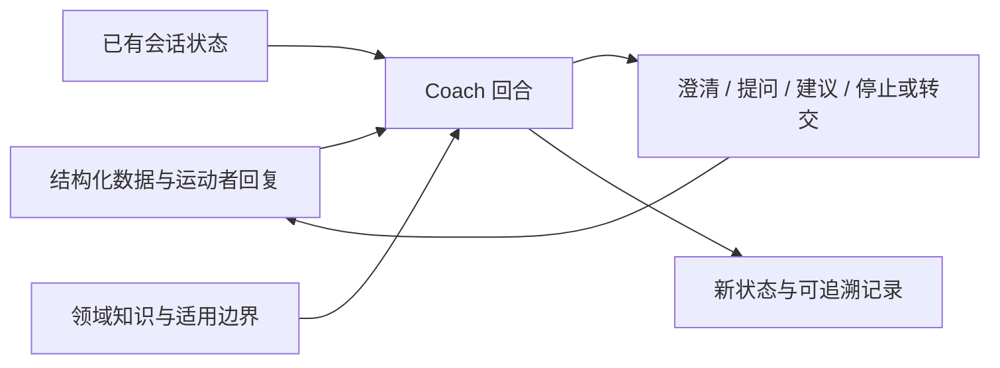

# AI Coach 最小运行单元

状态：设计草案 v0.1.0。用于约束当前 Skill 模拟，并为 App Agent 实现提供接口与验证依据；不是已实现的产品运行时。

本文件是 Coach 模拟的主入口。专家可维护本架构及其 [回合契约](turn-contract.md)、[对话原则](dialogue-policy.md)、[验证设计](evaluation.md) 和记录模板。Skill 负责读取与执行，不另存一份决策规则；修改边界见 [专家维护说明](../docs/expert-maintenance.md)。

## 两条建设目标

- 知识建设：完善判断依据、有效问题、适用条件、反例、行动和复评知识，维护在 knowledge/。
- Agent 建设：明确如何使用这些知识、选择下一步、管理事实和对话状态，维护在 agent/。

四个功能 Skill 保持不变。场景生成提供测试输入；Coach 模拟执行核心决策协议；专家访谈收集专业和行为反馈；知识编辑将修改分别落实到知识、Agent 设计或测试场景。专家入口负责模式切换与协调。

## 最小运行单元是什么

一次 Coach 回合：接收一个经过角色识别的运动者事件及已有状态，读取必要知识，选择一个下一步动作，返回用户话术、结构化决策记录和状态更新。多次回合构成完整的提问—回答—判断—建议过程。

专家模式识别属于模拟工作台：它先区分运动者事件和专家反馈，再把运动者事件交给 Coach。App 中由可信入口提供事件身份，普通用户不能凭一句“我是专家”获得知识编辑能力。专家角色、草稿编辑和 Git 操作均不进入面向运动者的 Coach 回合。

## 当前模拟与将来 App 的衔接

| 部分 | 当前实现方式 | App 需要实现的对应能力 |
| --- | --- | --- |
| 事实输入 | 分阶段 L0–L6 JSON 与实际逐轮回答 | 设备、训练记录、用户回复的结构化适配 |
| 知识读取 | 模型定位并读取本地 Markdown | 保留 ID、版本、范围和状态的检索接口 |
| 决策逻辑 | Skill 按回合契约执行 | 实现同一输入、输出、状态及行为规则 |
| 状态保存 | review-data 中的 Markdown | 隔离用户与会话的持久化、并发与重试处理 |
| 验证 | 专家点评、构造场景走读 | 固定测试集、运行日志、回归与产品评估 |

研发接入时应保持回合契约和可观察行为一致，但不要求产品使用 Markdown 作为运行时存储。App 实现落地后用相同测试验证；不能因复用了提示词就声称行为完全一致。

## 每次专家讨论应留下什么

1. **知识变化**：什么条件、证据或建议需要修订，关联知识单元 ID 和版本。
2. **行为变化**：Agent 在什么输入下应怎样改变提问、判断、停止或状态更新，记录具体触发与预期行为。
3. **验证场景**：一个能暴露该问题的输入和一个反例，记录预期可观察行为，不写唯一标准话术。

无需每次同时修改三项；先判断问题归属。流程与字段见 [回合契约](turn-contract.md)，检查方法见 [验证设计](evaluation.md)。

专业审阅、Agent 行为设计认可、实际模型测试、App 接入验证分别记录。当前均不得因本设计提交而自动标记通过。

输入结构及阶段缺省见 [L0–L6 输入模型](input-model.md)。JSON 保存业务事实，Markdown 保留说明和审阅。
