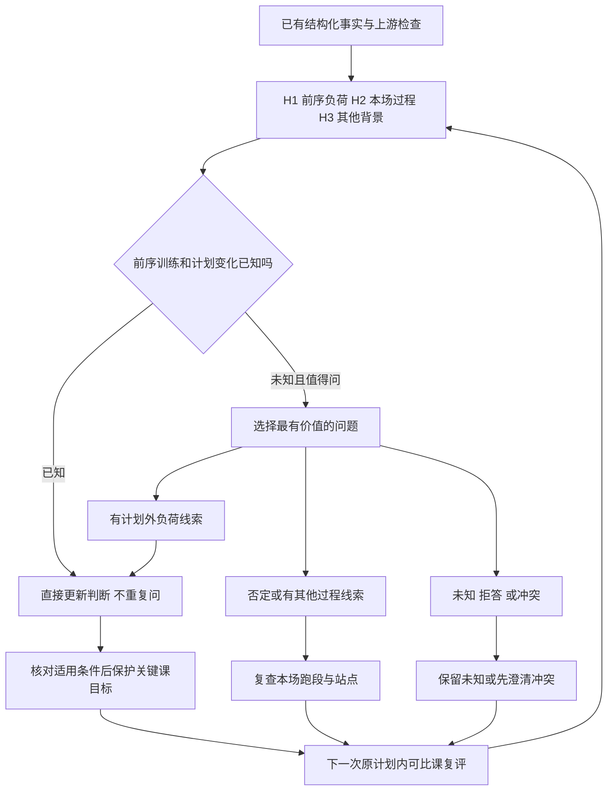

# HYROX 前一天加练影响关键课的问题包

这个样板讨论：一位用户在 HYROX 关键课中自述腿沉、后半程难以维持时，Coach 怎样读取现有事实、提出有判断价值的问题、根据回答更新解释，再选择符合条件的建议。

**建议先看 [完整示例与反例](../../cases/hyrox-prior-load-illustration.md)，再看 [判断单元](../../assessments/hyrox-prior-load.md)。** 所有新单元均为 `0.1.0 / draft`，待专家审阅；没有发布为正式检索知识，也没有完成模型运行验证。

## 本包要回答什么

- 前序下肢训练能否成为候选解释，什么事实能支持或削弱它？
- 前序训练未知时怎样提问，已有记录时怎样跳过？
- 回答支持、否定、记不清或互相冲突时，下一步怎样改变？
- 哪些条件足够形成有限建议，何时应停止继续追问？
- 什么结果会推翻本次判断，怎样保留反例？

“运动诊断”在此指表现问题及可能影响因素的分析，不把一次回答转成确定的生理因果。本包不是固定问卷；其中的顺序是可供专家修改的候选设计。

## 阅读路径

上游退出信号在所有普通分析前生效；图中的复评不要求用户额外训练。问题选择、预算和权限由运行系统管理，见 [目录与架构边界](../../STRUCTURE.md)。

## 单元索引

本表列出本包引用版本；修改任一单元后，需要复查受影响分支和本表。单元正文是唯一维护源，专题页只做编排。

| ID | 版本 | 职责 | 文件 |
| --- | --- | --- | --- |
| CON-HYROX-SESSION-CONTEXT | 0.1.0 | 输入含义与未知处理 | [输入说明](../../concepts/hyrox-session-context.md) |
| ASM-HYROX-PRIOR-LOAD | 0.1.0 | 候选解释及分支 | [判断单元](../../assessments/hyrox-prior-load.md) |
| Q-HYROX-PRIOR-TRAINING | 0.1.0 | 是否有前序训练 | [问题一](../../questions/prior-lower-body-training.md) |
| Q-HYROX-PLAN-CHANGE | 0.1.0 | 练过与超计划的区分 | [问题二](../../questions/prior-plan-change.md) |
| Q-HYROX-IN-SESSION-CHANGE | 0.1.0 | 本场变化起点 | [问题三](../../questions/in-session-change.md) |
| EVD-STRENGTH-TO-RUNNING | 0.1.0 | 跑者研究与迁移限制 | [证据一](../../evidence/strength-to-running.md) |
| EVD-HYROX-TASK-DEMANDS | 0.1.0 | HYROX 任务背景 | [证据二](../../evidence/hyrox-task-demands.md) |
| ACT-HYROX-PROTECT-KEY-SESSION | 0.1.0 | 保护关键课目标 | [行动一](../../actions/protect-key-session.md) |
| ACT-HYROX-OBSERVE-NEXT-SESSION | 0.1.0 | 信息不足时记录与观察 | [行动二](../../actions/observe-next-session.md) |
| ACT-HYROX-REVIEW-DISTRIBUTION | 0.1.0 | 复查本场分配 | [行动三](../../actions/review-session-distribution.md) |
| CASE-HYROX-PRIOR-LOAD-ILLUSTRATION | 0.1.0 | 构造对话与九种审阅变式 | [案例](../../cases/hyrox-prior-load-illustration.md) |

## 专家先看这四点

1. 本情境下，优先问前序负荷是否合适？什么情况下应先问其他问题？
2. 有加练、没加练、记不清三种回答，是否真的改变了判断和行动？
3. “保护关键课目标”在哪些情况下仍然过于武断？
4. 哪些反例、项目知识和研究还需要补充？

请直接修改相应 Markdown 或填写 [审阅记录](../../governance/reviews/hyrox-prior-load-v0.1.0.md)。反馈不必把全包一次性认定为正确，可以只审一个单元或一条分支。

## 来源与填写入口

- [来源映射](../../sources/hyrox-prior-load.md)：历史 HYROX 文章 revision 9、章节映射及两篇本次核对的研究。
- [专家模板](../../../templates/README.md)：填写新问题包、判断、提问、证据、行动与案例。
- [维护与审阅规则](../../governance/README.md)：草稿、确认、争议和正式检索的区别。
